# CoE Dashboard: billing & collection for a firm's leadership, built entirely inside Microsoft 365 and Azure

The leadership of a Malaysian accounting and advisory firm uses it to see whether billing is on budget, which debtors need chasing, and what was agreed about each one. It replaced a 17-page Power BI report.
In use since July 2026 by the firm's COO and the heads of Tax & Audit, Accounting, Business Advisory and Company Secretarial.

Building the charts was the easy part. This page explains **how the pieces fit together**, and why each was chosen: where the data lives, who can see it, what it costs to run, and how a comment made in a meeting turns into a follow-up that actually happens.

> **About the data:** every number, company and person on this page and in the demo is made up. The real dashboard runs on the firm's own data and is private.

| | |
|---|---|
| 🖱️ **[Try the demo](https://trisglenanne9.github.io/coe-dashboard/)** | the real dashboard with made-up data, in your browser, no login |
| 📘 **[User guide](docs/GUIDE.md)** | every tab, chart, filter and definition |
| 🛠️ **[Technical architecture](docs/ARCHITECTURE.md)** | the same design in developer detail |

## How it works

The diagram plays the story in 8 steps; the caption at the top right says what is happening. Icons: Microsoft's Azure architecture icons and the Excel, SharePoint and Outlook product icons.

## The problem it solves

Billing and collection were reported from a 17-page Power BI file built on about 30 spreadsheets. Everyone who opened it needed a Power BI licence, refreshing it depended on one desktop computer, and it stopped at the numbers: what the leadership decided about a late-paying client, and who would follow up, was not tracked next to the figures.

## The design choices, in plain terms

| Choice | Why it matters |
|---|---|
| **Leave Finance's spreadsheets where they are** | Finance keeps working exactly as before. Nobody re-types data, and there is no second copy to keep in step. The dashboard only ever *reads* the files. |
| **Build on Microsoft 365 and Azure, which the firm already has** | People sign in with the company login they already use, and no new vendor holds the firm's data. |
| **Pay only when it is used** | Nothing runs all day waiting. The system wakes up when someone opens it or presses Refresh, so the running cost is close to RM 0 a month, with no Power BI licences. |
| **Keep the data locked away** | The store holding the figures has no public door. Each screen gets a one-hour pass to read only the figures it needs, and only company accounts can log in. |
| **Turn comments into action items** | A decision sits right next to the number it is about, with an owner and an Open / Closed status. Nothing is forgotten between meetings. |
| **Chase quiet items automatically** | If an open item has no update for 6 days, its owner gets one email listing it, then another every 3 days until it is updated or closed. Emails come from one shared company mailbox approved by IT, and only go to company addresses. |
| **Keep a record** | Nothing in the comment history is ever deleted, and every Saturday a frozen copy of the whole dashboard is saved to SharePoint. |

## How we know the numbers are right

- **Matched the old report before go-live.** 150 of 150 figures across all four tabs and seven company views matched the Power BI report, and monthly billing per company matched to the ringgit. A second, independent rebuild from the raw June spreadsheets matched 56 of 56.
- **Checked against itself.** 136 automatic checks confirm that every tile, chart and table agrees with the others.
- **One cut-off date for everything.** Month to date, year to date, weekly and last-year figures are all measured to the same day, so one mistyped invoice date cannot shift the month.
- **Shows its age.** The page shows when the figures were last collected. If a refresh fails, the previous figures stay on screen and the person who pressed Refresh is told why.

## See it working

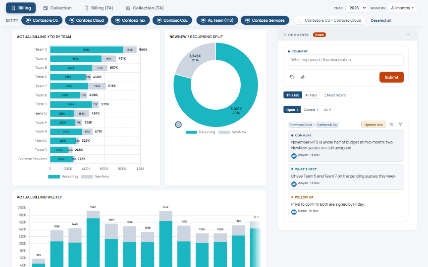

### What it shows

- **Billing:** are we on budget this month and this year, compared with last year? Is the growth coming from new engagements ("NewNew") or from existing clients ("Recurring")?
- **Collection:** how long have clients owed us money, which teams and clients have the oldest balances, and which have been passed to a collector or written down?
- **Billing (TA) and Collection (TA):** the same two questions for the Tax Advisory practice, which has its own budget and its own clients.
- **Comment board:** on every tab, what was decided, what happens next and who follows up.

### See where we stand

<table>
<tr>
<td width="50%"><b>Billing against budget</b>: this month and this year, against budget and last year 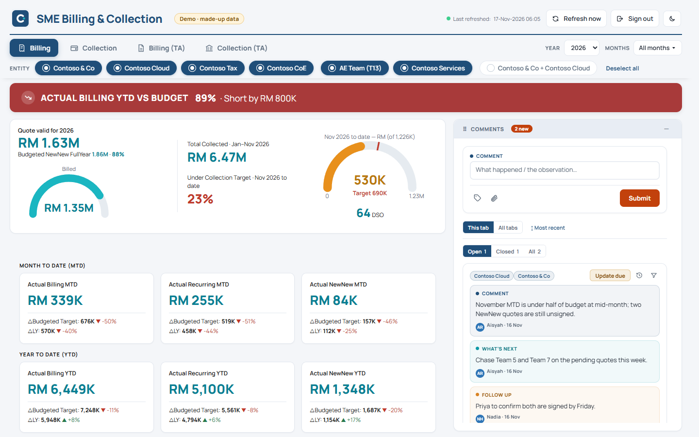</td>
<td width="50%"><b>New versus recurring work</b>: by team, and week by week 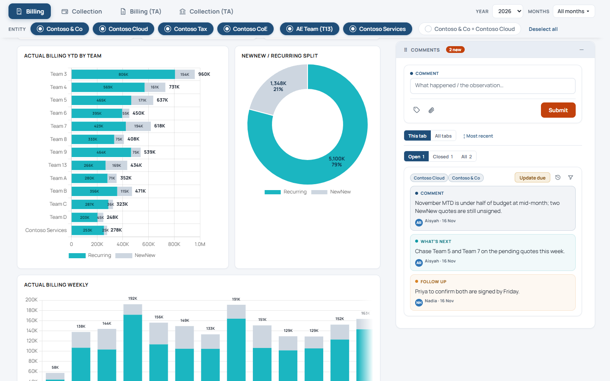</td>
</tr>
<tr>
<td colspan="2"><b>Who owes us, and for how long</b>: the debtor book by age and by business unit 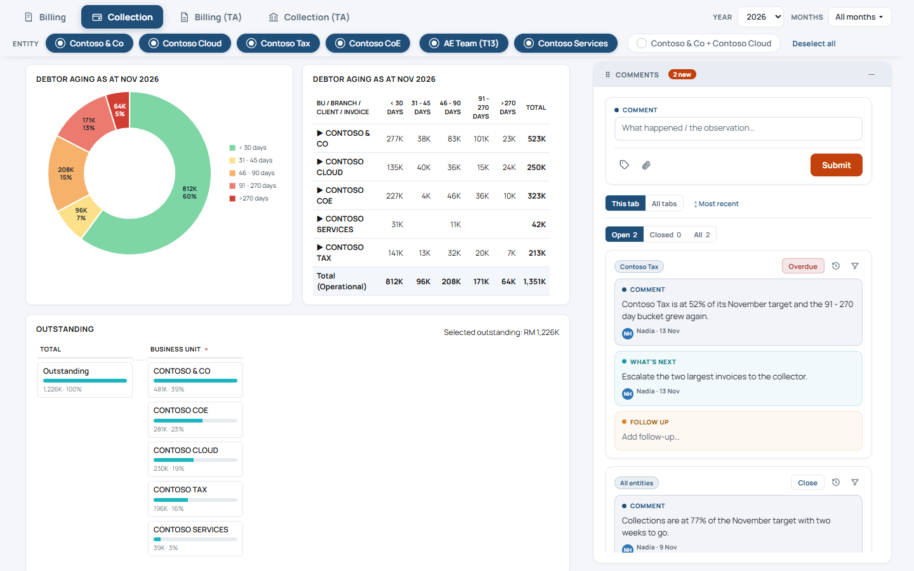</td>
</tr>
</table>

### Find the cause

<table>
<tr>
<td width="50%"><b>Filter by company and month</b>: every figure on the page follows 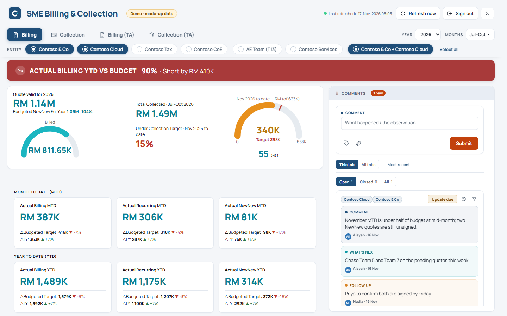</td>
<td width="50%"><b>Click a chart to filter everything</b>: one click on “NewNew” and every chart shows only new work; the ✕ clears it 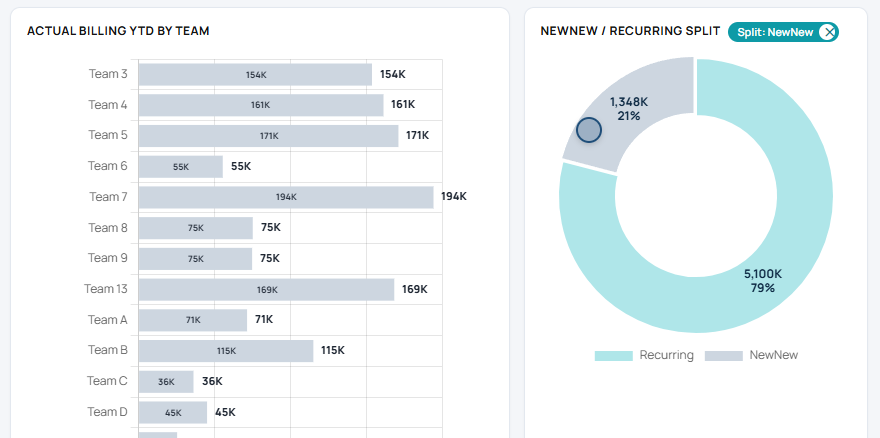</td>
</tr>
<tr>
<td width="50%"><b>Drill down to the invoice</b>: company, then team, then client, then the invoices themselves 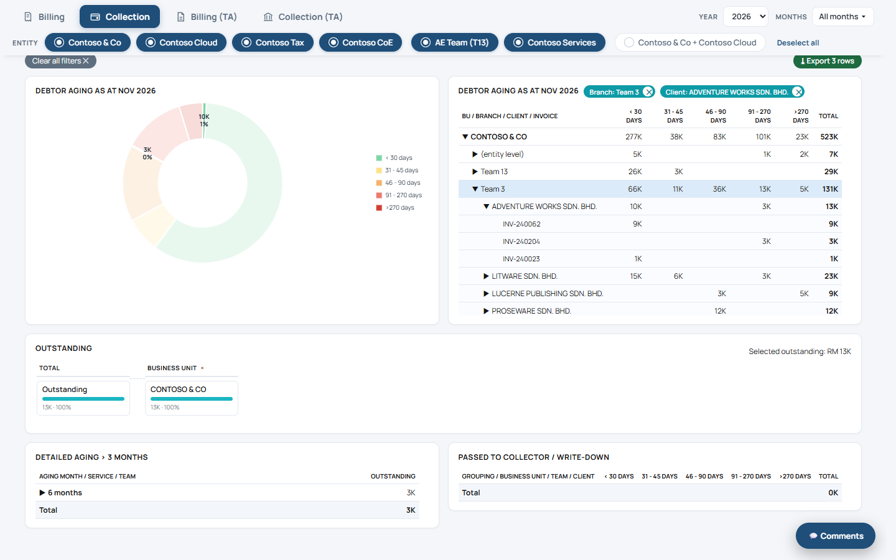</td>
<td width="50%"><b>Split the balance any way</b>: the outstanding balance broken down step by step 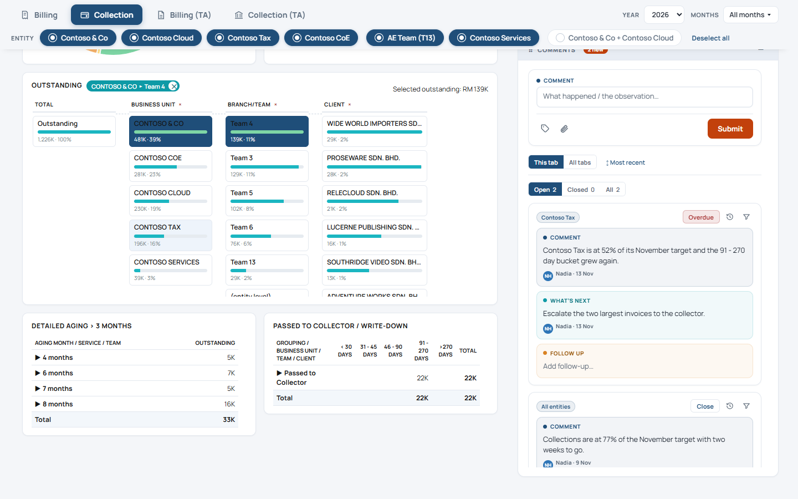</td>
</tr>
</table>

### Act on it

<table>
<tr>
<td width="50%"><b>Write it down next to the number</b>: what happened, what's next, who follows up, and which companies it concerns 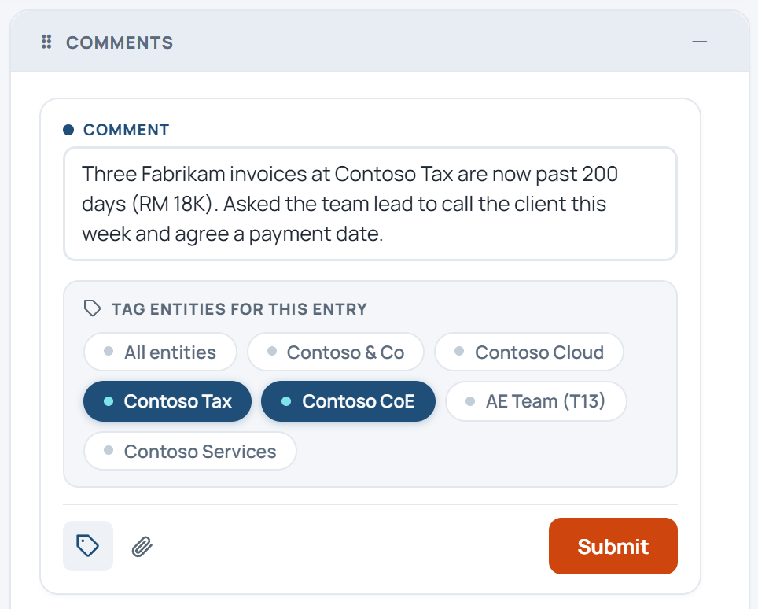</td>
<td width="50%"><b>Action items with a status</b>: Open or Closed, and flagged when an item goes quiet 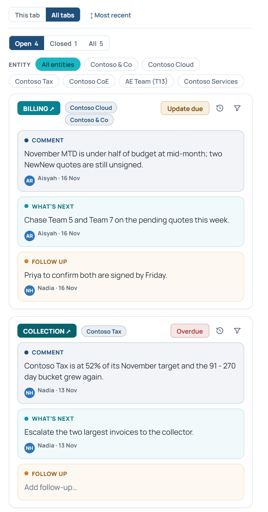</td>
</tr>
<tr>
<td width="50%"><b>Closing needs a confirmation</b>: only the writer or an admin can close an item 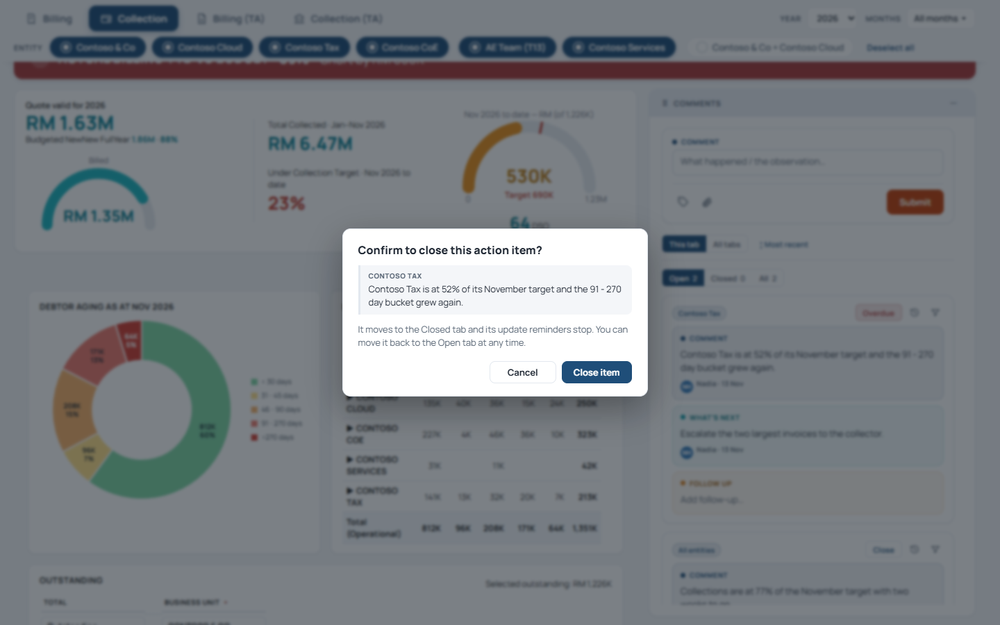</td>
<td width="50%"><b>The reminder email</b>: what an owner receives when items go quiet for 6 days 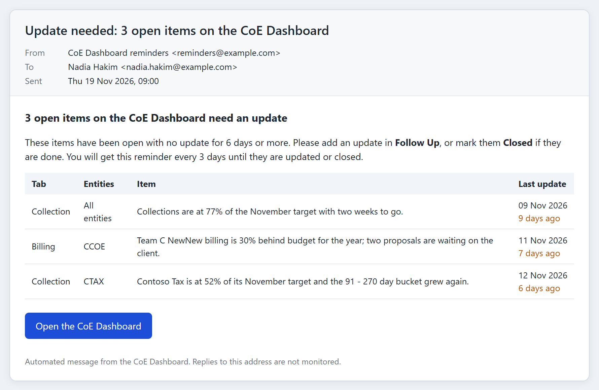</td>
</tr>
</table>

### Keep it running

<table>
<tr>
<td width="50%"><b>Fresh figures on request</b>: Refresh now, and the time the figures were last collected 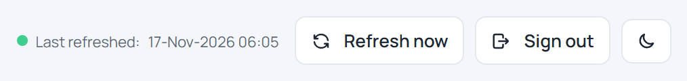</td>
<td width="50%"><b>Export what you see to Excel</b>: exactly the rows behind the current view 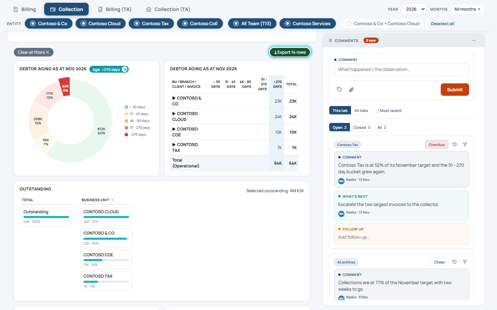</td>
</tr>
<tr>
<td colspan="2" align="center"><b>On a phone</b>: the same dashboard, laid out for a small screen 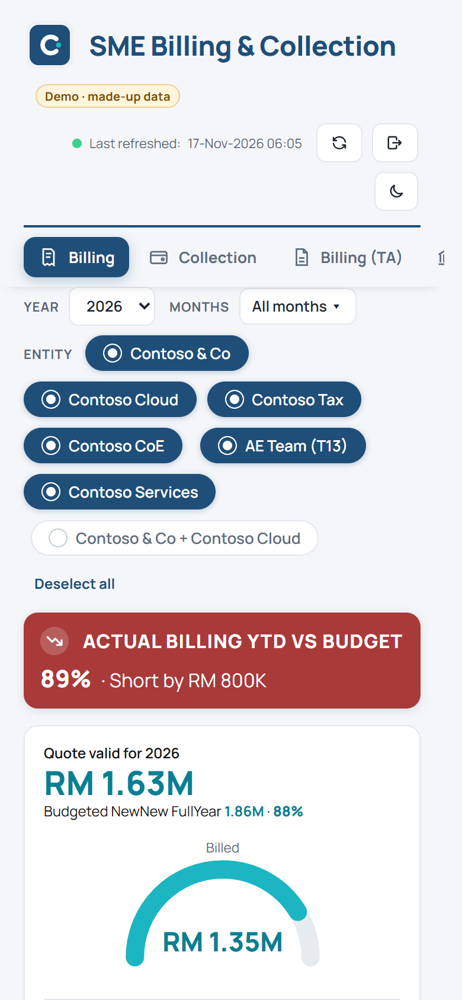</td>
</tr>
</table>

## What it is built with

All Microsoft, all inside the firm's own setup:

| Service | Its job here |
|---|---|
| **SharePoint** | where Finance keeps the spreadsheets, and where the weekly frozen copy is saved |
| **Azure Functions** | collects and prepares the figures, and sends the reminders |
| **Azure Storage** | the locked store for figures, comments and attachments |
| **Azure Static Web Apps** | delivers the dashboard to the browser |
| **Microsoft Entra ID** | the company login |
| **Outlook (Exchange Online)** | sends the reminder emails from one shared mailbox |
| **Application Insights** | keeps a log of every refresh, reminder and error |

## By the numbers

| | |
|---|---|
| Used by | the COO and four heads of department |
| Spreadsheets read | about 30, never changed |
| Refresh | about 20 seconds, on request and every Saturday |
| Accuracy at go-live | 150 of 150 figures matched the old report |
| Running cost | close to RM 0 a month; no Power BI licences |
| In use since | July 2026 |

## For technical readers

The developer view (every Azure service, the data layer, the security model, the reminder logic and the delivery pipeline) is in **[docs/ARCHITECTURE.md](docs/ARCHITECTURE.md)**, with a detailed diagram.

## Made by

**trisglenanne9**
