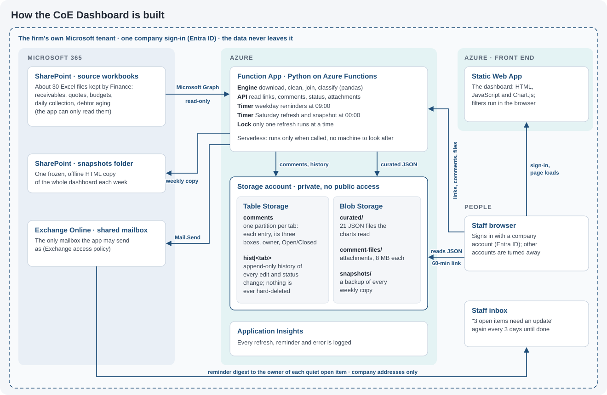
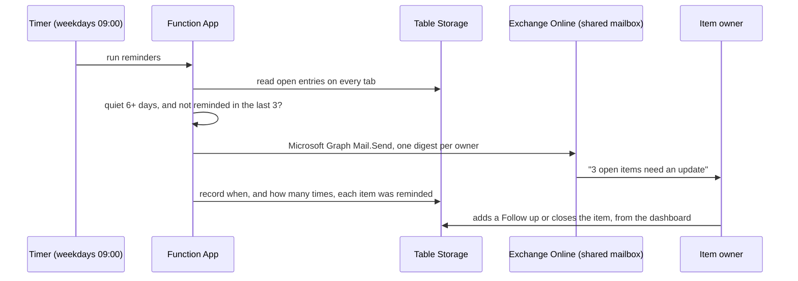

# Technical architecture

> All names, figures and screenshots in this repository are made up. The real system runs on a firm's own data and is private.
>
> This is the developer view. The plain-language overview, with the reasons behind each choice, is in the [README](../README.md#how-it-works).

## 1. The constraint that shapes it

**The source of truth stays where Finance keeps it: about thirty Excel workbooks on SharePoint.** Nobody re-keys data, nothing writes back to those files, and the dashboard has to match the Power BI report it replaced figure for figure before anyone trusts it. Everything else follows from that: a read-only pipeline that turns the workbooks into small curated files, and a front end that only draws finished numbers.

The second constraint is cost: no Power BI licences, no always-on server, no database server. The recurring bill is close to zero.

The third is **where it may live: inside the firm's own Microsoft tenant.** The sources are already in SharePoint, staff already sign in with Microsoft accounts, and IT already runs Exchange Online. So the engine, the data, the front end and the email all run on Microsoft 365 and the firm's Azure subscription, under the same sign-in. No outside service ever holds the data.

## 2. Where everything runs

| Box | Service | What it does |
|---|---|---|
| Source workbooks | SharePoint (Microsoft 365) | Holds the Excel files. Finance updates them; the dashboard only reads. |
| Function App | Azure Functions, Python | Downloads the workbooks, runs the pandas pipeline, writes curated files, mints read links, stores comments and attachments, sends reminder emails, freezes the weekly snapshot. 15 HTTP endpoints and 2 timers. |
| Storage account | Azure Blob + Table Storage | One private account for everything the app keeps: curated data, attachments, snapshot backups (Blob) and comments with their history (Table). See [the data layer](#5-the-data-layer). |
| Static Web App | Azure Static Web Apps | The dashboard itself: a shell page and four tab pages. All filtering happens in the browser. |
| Sign-in | Microsoft Entra ID | Company accounts only, on every route. |
| Shared mailbox | Exchange Online | The one mailbox the app may send reminders from. |
| Monitoring | Application Insights | Logs every refresh, reminder run and error. |

## 3. Data sources

| Source | Holds | Access | Refresh | Notes |
|---|---|---|---|---|
| Receivable exports | one workbook per entity per year since 2020; every invoice and credit note line | Graph, by file ID | on demand + weekly | all years are stacked; about 244,000 lines |
| SME quote register | contract value, billed, remaining to bill | Graph | on demand + weekly | joined on entity + client + service |
| Tax Advisory quote report | accepted task amounts | Graph | on demand + weekly | optional: the refresh carries on without it |
| Daily collection report | summary per entity / team (collected, target, under target, aging balance) and a per-collection record | Graph | Finance updates it daily | targets exist for the current month only |
| Debtor aging | invoice-level balances, aging days and month, grouping (e.g. passed to collector) | Graph | monthly | |
| Entity master and budgets | entity list; budget by team × month × NewNew / Recurring × scenario | Graph | when Finance changes them | |

The engine reads with an app-only, read-only Graph permission scoped to the sites it needs. A missing *required* source fails the refresh loudly; an optional one is skipped and logged.

## 4. Pipeline

| Step | What happens | What it guarantees |
|---|---|---|
| Extract | Eight parallel Graph downloads to a temp folder; each workbook and sheet is read once | the run sees one consistent set of files |
| Clean | keep invoices and credit notes; drop excluded contacts and staff secondments; apply the team whitelist (dropped blank-team rows are logged, not silent) | no row disappears without a trace |
| Classify | account code 700… = Other Income, "CN" in the number = credit note, else Revenue; 65 ordered text rules assign the service line | one rule set, in code, instead of hand-coded report overrides |
| Combine | join invoices to the quote register; label NewNew / Recurring; weeks run Friday to Thursday | NewNew ties to the quote register's Billed figure |
| Cut | one as-of date for every window: the latest invoice that is not in the future | MTD, YTD, weeks and last year always describe the same day |
| Store | upload the curated files in parallel with no-store caching, then a `status.json` stamp | the stamp is written last, so it never claims data that isn't there |

A full refresh of about 30 sources takes around 20 seconds.

## 5. The data layer

Everything the app keeps lives in **one private Azure Storage account**. Blob Storage holds files; Table Storage holds the comments. There is no SQL server.

| Store | Service | Holds | Key design | Written by | Read by |
|---|---|---|---|---|---|
| `curated/` | Blob | 21 JSON files (plus Parquet and CSV copies) and `status.json` | whitelisted names only; no-store caching; `status.json` written last | engine, each refresh | browser, through a 60-minute read-only link per file |
| `comments` | Table | one row per entry | partition = tab (Billing, Collection, Billing (TA), Collection (TA)); each row holds the three boxes, who wrote each part, entity tags, Open / Closed with who and when, last activity, reminder time and count, and a soft-delete flag | API | dashboard |
| `hist\|<tab>` | Table | every earlier version of every box, every deletion and every close or reopen | append-only; the row key carries a reversed timestamp, so the newest change reads first | API | the edit-history pop-out |
| `comment-files/` | Blob | attachments: images shown inline, documents downloaded; 8 MB each, 6 per entry | served like curated data, through short-lived links that renew themselves; a weekly sweep removes files no entry uses after 7 days | API | browser |
| `snapshots/` | Blob | a copy of every weekly frozen dashboard | kept even when the SharePoint upload fails | Saturday timer | admins |
| refresh lock | Blob | one small lock file | expires after 15 minutes, so a crashed refresh never blocks the next one | engine | engine |

**Why Table Storage for comments:** they are small records that are always read one tab at a time, which is exactly what a key-value table partitioned by tab is good at. It needs no server, costs almost nothing, and sits in the same private account as everything else. An Azure SQL option was costed and not needed at this size.

## 6. Comments, action items and reminders

Every entry on the comment board is an action item with three boxes: **Comment** (what happened), **What's next** and **Follow up**. Anyone signed in can add to any entry. People can reword their own text for 6 hours and add to it at any time. An entry can only be deleted whole if every word in it is theirs, and even then it is a soft delete.

**Status.** An entry is Open until its writer, or an admin, closes it after a confirmation. *Update due* shows from the fourth quiet day and *Overdue* after the sixth. Any new words, file or status change counts as activity.

**Reminders.** A timer runs every weekday at 09:00 Malaysia time:

1. It reads the open entries on every tab. If a tab cannot be read in full, the run stops rather than send a partial picture.
2. It keeps the entries with no activity for 6 days that have not already been reminded in the last 3 days of this quiet spell.
3. It groups them by owner and sends each owner **one digest**: tab, entities, the item's text and when it was last updated, with a link to the dashboard.
4. It records the reminder time and count on each entry. The next reminder comes 3 days later, until the item is updated or closed.

Mail is sent through Microsoft Graph (`Mail.Send`). An **Exchange application access policy** limits the app to one shared mailbox, so every email comes from that address, and the app cannot send as anyone else. Recipients must be on the company's email domains, so no request can turn the dashboard into a relay. A start date keeps items that were already quiet when reminders were switched on from being emailed all at once. A preview mode lists who *would* be emailed without sending anything.

## 7. Data model & definitions

- **Actual billing** = net of Revenue + credit notes. Other Income is excluded for SME, included for Tax Advisory.
- **NewNew** = billing on a quoted engagement (quote reference, or the quote still has amount to bill). **Recurring** = the rest.
- **Budget** = the operation scenario; YTD budget counts whole months up to the as-of month.
- **Collection %** = collected ÷ target. **Under target %** = under ÷ target.
- **DSO** = aging balance ÷ rolling 12-month revenue × active days (at most 365).
- **Outstanding** = balance − collections, floored at zero.
- **Aging buckets**: under 30, 31–45, 46–90, 91–270, over 270 days.

The full list is in the [user guide](GUIDE.md#definitions).

## 8. Refresh & monitoring

- **On demand**: a *Refresh now* button. A lock with a 15-minute expiry stops two refreshes overlapping; the second caller is told it is busy.
- **Weekly**: every Saturday at 00:00 (Malaysia time) a timer refreshes, then freezes the whole dashboard into one self-contained HTML file and saves it to SharePoint, with a backup copy in Blob Storage. Filters and drill-downs still work in the frozen copy, offline.
- **Last refreshed**: the page shows when the engine last pulled the sources. That is not the age of the source files, which the guide explains.
- **Failure**: the old data stays; the person who pressed Refresh sees the error; logs go to Application Insights. A tab that fails to load shows one notice with a Retry button.

There is deliberately no hourly or daily timer: the data refreshes when someone asks, and at least once a week.

## 9. Hosting & access

- Every route of the Static Web App requires a Microsoft sign-in; other identity providers are switched off.
- After sign-in, personal Microsoft accounts and anyone outside the company's email domains get an *Access denied* page.
- Sign-out ends both the app session and the Microsoft session, so it does not quietly sign you back in.
- Anyone signed in can read and comment. Closing or reopening a comment is limited to its writer and named admins.

## 10. Security & privacy

- **No connection string or storage key ever reaches the browser.** The page asks the Function App for a read-only link per curated file, valid for 60 minutes, and only for files on a whitelist. The storage account itself is private.
- The engine's Graph permission is read-only and limited to the sites it needs.
- Secrets live in the Function App's settings and the CI system's protected variables, never in the repository. The repository history was scanned for keys, tokens and signed links before this showcase was made.
- Comments are never hard-deleted from the app: edits and deletions are appended to an audit trail.
- Email reminders go only to company addresses, from one shared mailbox approved by IT.

## 11. Delivery

- **Branch, merge request, merge.** Every push runs a `validate` job: Python must compile, and every inline `<script>` in every page must parse (checked with Node), so a stray brace cannot ship green.
- **Front end:** merging to `main` deploys the Static Web App automatically.
- **Engine:** deployed with one click from the pipeline, or with a PowerShell script from a workstation. It stays manual because the shared CI runner lacks the disk space the Functions tooling needs.
- **Local development:** a small Python server runs the whole dashboard with generated data and a stubbed sign-in, with no Azure at all.

## 12. How accuracy is checked

1. **Match the old report first.** Power BI visuals were exported and diffed row by row against the new engine with a reconciliation script (keys plus tolerance). The `.pbix` model, its Power Query steps and its DAX measures were read to find every rule.
2. **Result before go-live**: 150 / 150 figures across 4 tabs and 7 entity views; per-entity monthly billing tied to the ringgit; an independent rebuild from raw June workbooks matched 56 / 56.
3. **What the reconciliation found**, in the old report and in early versions of the new one: rows with blank grouping keys silently dropped; rows with no branch dropped (about a tenfold under-count for one view); account codes misaligned with invoices after a filter; a DSO denominator that was annualised; Other Income excluded where it belonged; a headline wired to a detail measure; two hand-coded overrides that only existed in the report; a future-dated invoice moving the as-of date; credit notes tagged as NewNew.
4. **Ongoing**: a cross-file consistency check (136 checks) on live data; about 100 scripted test cases for mail, status, reminders, term windows and CSV export.
5. **CI on every push**: Python must compile and every inline `<script>` in every page must parse, so a stray brace cannot ship green.

## 13. Design decisions

| Decision | Why | Rejected |
|---|---|---|
| Static front end + small curated JSON | files are small, so filtering in the browser is instant and needs no server | a SQL database and API (costed; not needed at this size) |
| All calculations in the engine | one place to reconcile; the pages only draw finished numbers | measures in the front end, as in Power BI |
| Private storage + 60-minute links | the data is detailed financials | one public JSON file, as an earlier dashboard did |
| Static Web Apps, Free tier, Microsoft sign-in | company sign-in at no cost | Standard tier with a dedicated Entra app |
| One page per tab, inside a shell | tabs cannot break each other's scripts or styles | one large single-page app |
| Weekly frozen single file | SharePoint's viewer will not run scripts inside frames, so the snapshot inlines everything | a folder of linked files |
| Comment board inside the dashboard | the decision sits next to the number it is about | a separate tracker |
| Table Storage for comments | small records read one tab at a time; no server; same private account | an Azure SQL database |
| Reminders from one shared mailbox, enforced by Exchange policy | the app can never send as a person; IT approves one sender | sending as whoever triggered the email |
| Everything on Microsoft 365 and Azure | same sign-in, same tenant, data never leaves it, nothing new for IT to vet | third-party BI or SaaS tools |

## 14. Known limits

- The tab code exists twice, once live and once in the snapshot generator, so the two can drift.
- Some source workbooks are matched by file name pattern; renaming one breaks the refresh until the pattern is updated.
- Collection targets exist only for the current month.
- Tax Advisory has no last-year comparison.
- It is an SME-teams view, not firm-wide billing: a team whitelist decides what is in.
- A cold start adds about four seconds to the first load of the day.
