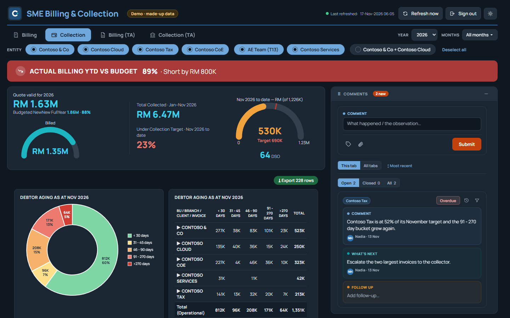
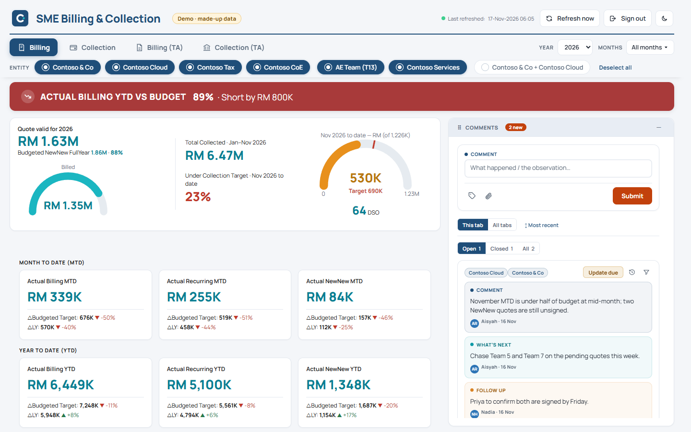
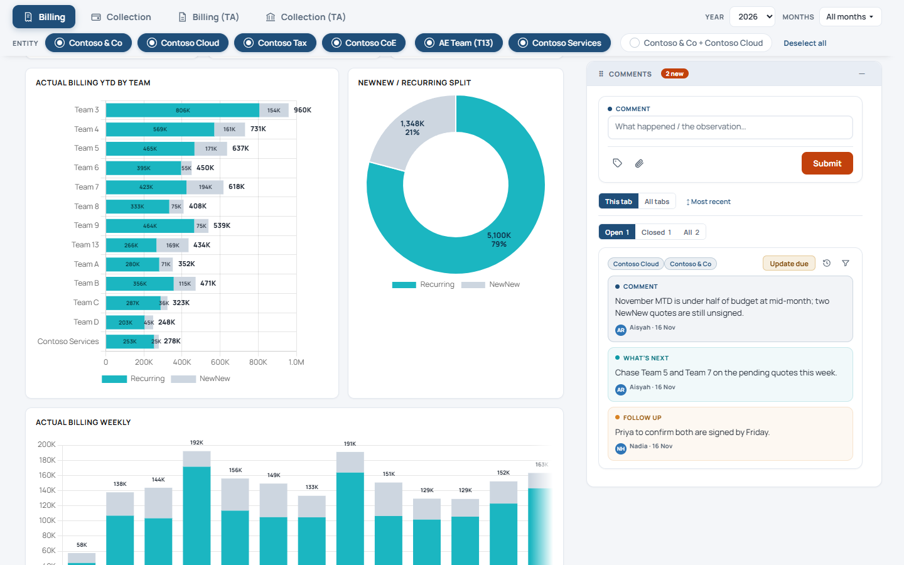
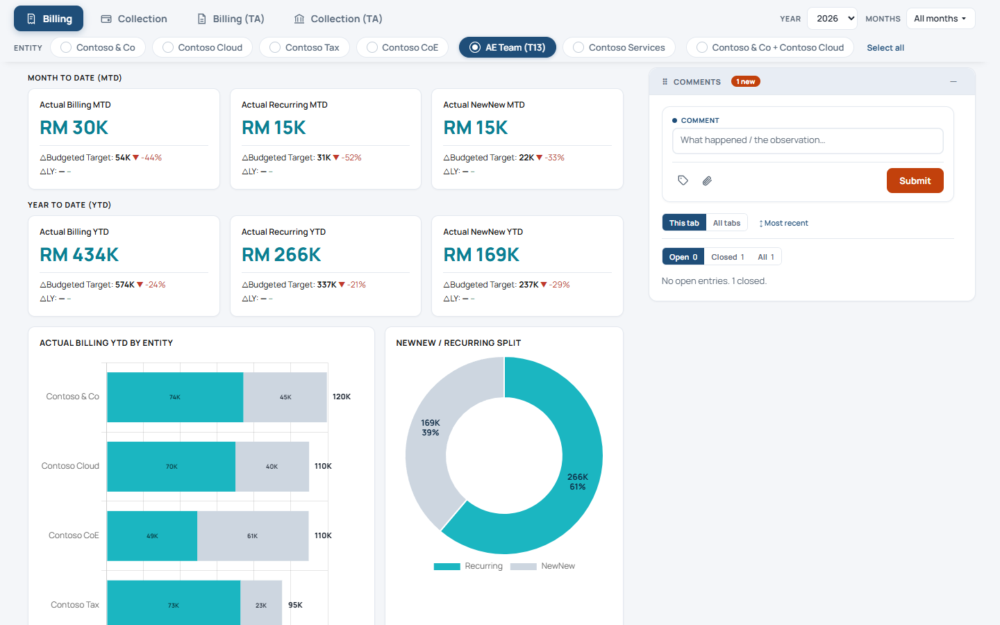
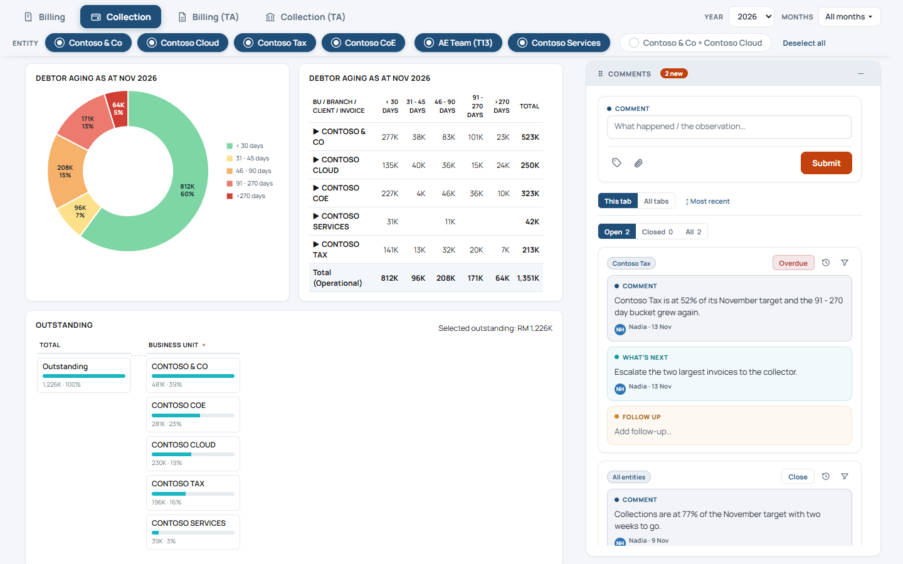
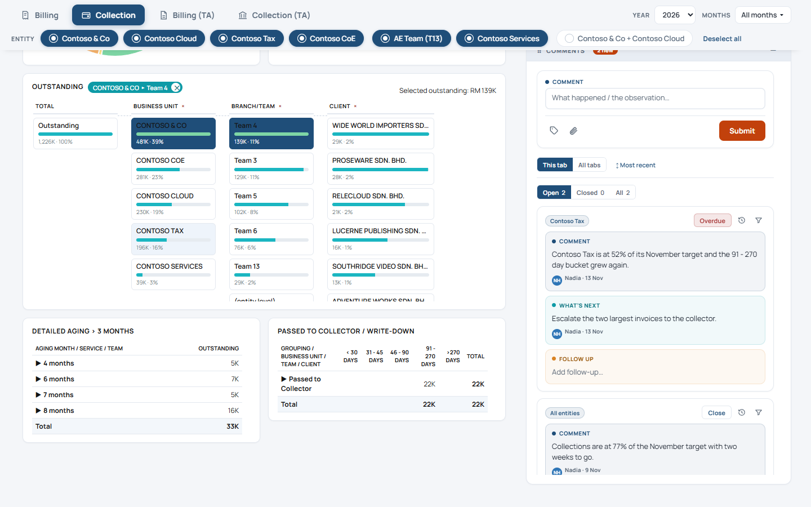
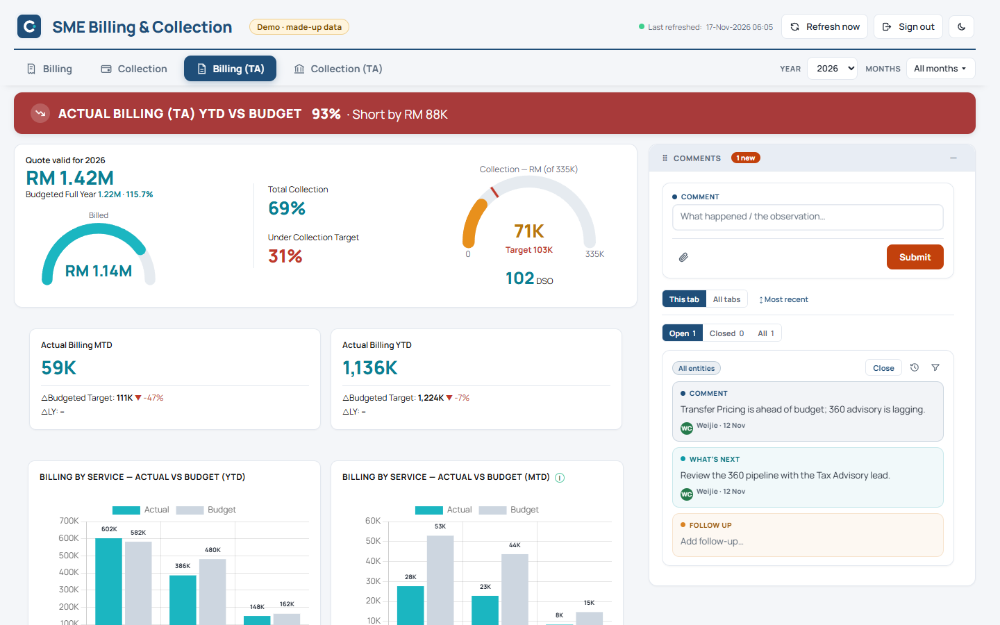
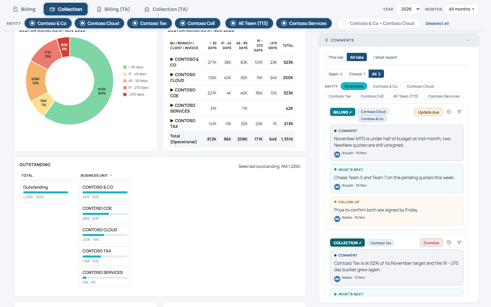

# User guide

> All names, figures and screenshots in this repository are made up. The demo uses five fictional entities (Contoso & Co, Contoso Cloud, Contoso Tax, Contoso CoE, Contoso Services) and fictional clients.

## 1. Who uses it and for what

The firm's leadership: the COO and the heads of Tax & Audit, Accounting, Business Advisory and Company Secretarial. They use it to:

- see whether billing is on budget this month and year to date, and against last year;
- see whether growth comes from new engagements (**NewNew**) or existing clients (**Recurring**);
- decide which debtors to chase, which to pass to a collector, and which to write down;
- record what was decided about a number, and follow it up until it is closed.

## 2. The routine

| When | What |
|---|---|
| Daily | Finance updates the collection report. Anyone can press **Refresh now** to pull it in (about 20 seconds). |
| When management reviews the numbers | Walk the four tabs; add or update comments on the numbers discussed; close what is done. |
| Every Saturday 00:00 | The dashboard refreshes itself and a frozen copy of the whole thing is saved to SharePoint for the record. |
| Weekdays 09:00 | Anyone whose open comment has had no update for 6 days gets a reminder email, then every 3 days until it is updated or closed. |
| Start of the month | Finance rolls the collection targets to the new month. Early in the month, collection % looks low by design. |

## 3. The views

### Controls on every tab

- **Year** and **Months**: pick a year, then one or more months (or *All months*).
- **Entity chips**: one chip per entity, plus *AE Team* (a team that works across entities) and a preset that combines two entities. *Select all / Deselect all* at the end.
- **The banner**: *Actual Billing YTD vs Budget*, with the % achieved and *Short by* (red) or *Exceed by* (green).
- **The tile**: Quote valid, Budgeted NewNew for the year, the *Billed* gauge, Total Collection, Under Collection Target, the collection gauge (what has been collected out of the aging balance, with the target as a red tick) and DSO.
- **Dark mode**: the moon / sun button; the choice is remembered in your browser.

  

- **Shareable state**: the tab and filters live in the address bar, so a copied link opens the same view, and Back / Forward work.
- **Keyboard**: arrow keys move between tabs; every chip, row, tree node and card works with Enter or Space; Esc closes menus.

### Billing

*Are we on budget, and where is the growth coming from?*

- **MTD and YTD cards** for Billing, Recurring and NewNew. Each shows the difference from budget and from last year.
- **Actual Billing YTD by Team**: a stacked bar per team, split into NewNew and Recurring. With the AE Team chip on, it shows the same split by entity instead.
- **NewNew / Recurring donut**: the mix for the selected period.
- **Weekly bars**: one bar per week (Friday to Thursday), scrollable, opening on the latest week.
- **Cross-filtering**: click a team, a donut slice or a week, and every other panel follows. A ✕ badge marks each panel's active filter; *Clear all filters* resets them.

With only the *AE Team* chip on, the team chart turns into billing by entity:

### Collection

*How old is the debtor book, and who should we chase?*

- **Debtor Aging donut**: five buckets (under 30, 31–45, 46–90, 91–270, over 270 days). Clicking a bucket highlights it inside the whole book instead of shrinking the chart, so you keep the proportion in view.
- **Aging matrix**: business unit → team → client → invoice, with a column per bucket. Click a row to open the next level.
- **Decomposition tree**: split the outstanding balance by any of seven dimensions in any order; the *highest* and *lowest* buttons pick the split for you.

- **Detailed aging over 3 months**: the invoices that need attention.
- **Passed to collector / Write-down**: balances already handed over or written down.
- **Export**: *Export N rows* downloads a CSV of exactly the rows behind the current view, ready for Excel.
- **Note**: Year and Months move the DSO, the banner and the collection tile. The aging views are a point-in-time picture as at the aging date, so they do not move with the month filter.

### Billing (TA)

*Is the Tax Advisory practice on budget, by service?*

- MTD and YTD Actual vs Budget cards (there is no last-year comparison for this practice).
- Actual vs Budget by service, YTD and MTD.
- Weekly bars. Click a service or a week to cross-filter.

### Collection (TA)

The Collection tab for the Tax Advisory debtor book. It has the same layout, a six-dimension tree, and its own CSV export.

### Comment board

A side panel on every tab. You can move it, dock it or minimise it.

- **One list per tab**, plus *All tabs*. Each entry is tagged with one or more entities. The funnel button jumps to the entry's tab with its filters applied.
- **Three boxes per entry**: *Comment*, *What's next*, *Follow up*.
- **Who can change what**:
  - Anyone can add text to any entry.
  - You can reword or remove your own text for 6 hours.
  - *Follow up* stays open.
  - You can delete a whole entry only if every word in it is yours.
- **Status**: Open or Closed, with counts.
  - *Update due* appears after 4 quiet days.
  - *Overdue* appears after 6 quiet days.
  - Only the writer or an admin can close or reopen, after a confirmation.
- **Attachments**: images show inline and documents download. Up to 6 files per entry, 8 MB each.
- **History**: every earlier version and every close or reopen is kept and can be opened.

## 4. Definitions

| Metric | Definition |
|---|---|
| Actual billing | Net of invoices and credit notes. Other Income (account 700…) is excluded for SME and included for Tax Advisory. |
| NewNew | Billing on a quoted engagement: a quote reference, or a quote with amount still to bill. |
| Recurring | Billing that is not NewNew. |
| Entity YTD NewNew | The quote register's *Billed* figure, so it ties to the Billed gauge. |
| Budget | The operation scenario, NewNew + Recurring. YTD budget counts whole months up to the as-of month. |
| Banner % | YTD actual ÷ YTD budget. *Short by* = budget − actual. |
| Quote valid | Sum of this year's contract values. |
| Billed gauge | Billed ÷ contract value, over quotes with a contract value. |
| Total collection % | Collected ÷ this month's target. |
| Under collection target % | (Target − collected) ÷ target. |
| Collection gauge | Collected out of the aging balance; the red tick is the target. |
| DSO | Aging balance ÷ rolling 12-month revenue × active days (at most 365). |
| DSO (TA) | Aging balance ÷ this year's revenue × 365. |
| Outstanding | Balance − collections, never below zero. |
| Aging buckets | Days since invoice: under 30, 31–45, 46–90, 91–270, over 270. |
| As-of date | The latest invoice date that is not in the future. Every window is cut from it. |
| Week | Friday to Thursday. |

## 5. "Why does this number differ from …?"

| You see | Why | What to do |
|---|---|---|
| A different figure from the old Power BI report | Power BI was last refreshed on a different day, or a period was pinned in it | Compare on the same as-of date. The two matched figure for figure at go-live. |
| SME DSO and TA DSO disagree | They use different debtor books and different revenue bases, by design | Nothing to fix. |
| Collection % is low in the first days of the month | A few days of collections against a full month's target | Read it against the day of the month. |
| One entity shows 0 % collected | Nothing has been logged for it yet this month; the tile shows the last entry date | Ask Finance whether the collection report is up to date. |
| Aging charts don't move with Year / Months | They are a picture as at the aging date | Use the tile and banner for period figures. |

## 6. When something looks wrong

| Symptom | Likely cause | What to do |
|---|---|---|
| Numbers unchanged after a new release | A release ships code, not data | Press **Refresh now**. |
| *Last refreshed* is today but figures look stale | The refresh ran, but the source workbook had not been updated | Ask the Finance owner of that workbook. |
| A fix you were told about isn't there | Your browser kept the old page | Hard reload: Ctrl + Shift + R. |
| *Refresh failed* | A source was locked or unavailable; the old data is still shown | Try again in a few minutes. |
| A tab shows *couldn't load* | A network hiccup or an expired link | Press **Retry** on the notice. |
| You can't reword your comment | The 6-hour window has passed | Add a new line instead. |
| You can't delete an entry | It contains someone else's text | Remove only your own part. |
| You can't close an entry | Only its writer or an admin can | Ask them, or add a *Follow up*. |
